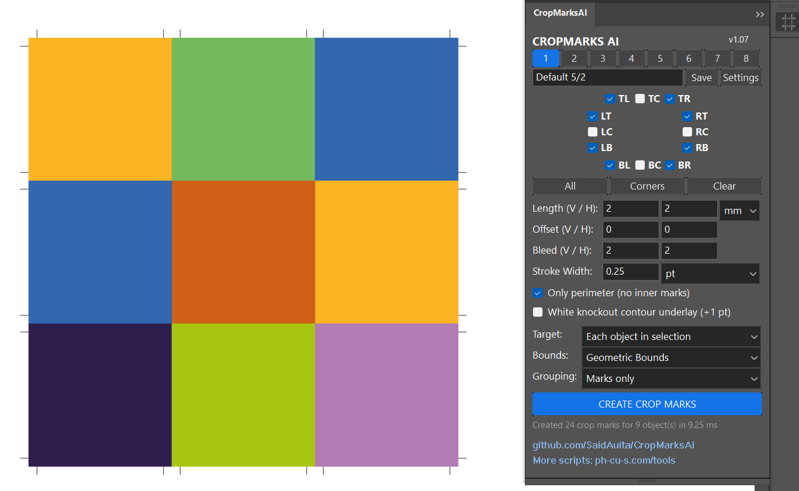
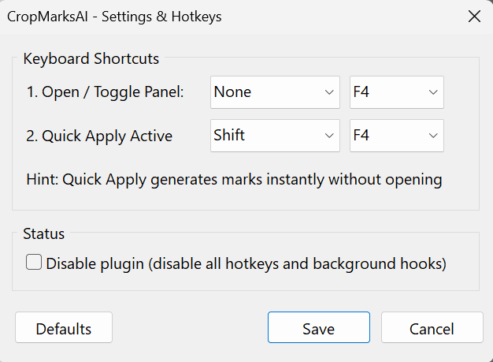

# CropMarksAI 📐🚀

[](https://www.adobe.com/products/illustrator.html)
[](https://isocpp.org/)
[](https://microsoft.com)
[](https://github.com/SaidAuita/CropMarksAI/releases)
[](LICENSE)

> **High-performance native C++ prepress plugin (`.aip`) for Adobe Illustrator (CC 2020 – 2026+ x64).**  
> Generates precision vector crop marks, fold marks, bleed offsets, and knockout underlays in sub-millisecond time (<1 ms) directly in Illustrator process memory.

<p align="center">
  
</p>

---

[English](#english) • [Русский](#-русский)

---

<a name="english"></a>
## English

> [!TIP]
> ### 📥 Download Latest Release
> **[CropMarksAI_Plugin_v1.08.zip](https://github.com/SaidAuita/CropMarksAI/releases/download/v1.08/CropMarksAI_Plugin_v1.08.zip)** *(Direct ZIP package with one-click installer)*  
> Full release notes & assets: **[Release v1.08](https://github.com/SaidAuita/CropMarksAI/releases/tag/v1.08)**

---

### ⚡ Key Features

1. **Ultra-Fast Native Performance (< 1 ms)**:
   - Direct geometry calculation and vector path construction inside `Illustrator.exe` address space using native Illustrator SDK suites (`sAIArt`, `sAIPath`, `sAIPathStyle`).
   - Up to 100× faster than traditional ExtendScript / JSX scripts on complex layouts with hundreds of objects.

2. **12 Independent Crop Mark Directions**:
   - Corner marks: Top-Left (`TL`), Top-Right (`TR`), Bottom-Left (`BL`), Bottom-Right (`BR`).
   - Side marks: Left-Top (`LT`), Left-Bottom (`LB`), Right-Top (`RT`), Right-Bottom (`RB`).
   - Center / fold marks: Top-Center (`TC`), Bottom-Center (`BC`), Left-Center (`LC`), Right-Center (`RC`).
   - One-click direction presets: `All`, `Corners`, `Clear`.

3. **Prepress Precision & Print Standards**:
   - **Registration Color**: Strokes are assigned true 100% Registration color (`sAICustomColor->GetCurrentRegistrationColor`), rendering on all separation plates.
   - **White Knockout Contour Underlay (`+1 pt`)**: Automatic white background stroke placed underneath the registration line for maximum visibility on rich black and dark backgrounds.
   - **Only Perimeter Mode (No Inner Marks)**: Creates marks strictly along the outer bounding perimeter of grouped layouts (cards, stickers, impositions), preventing unwanted internal cut lines.
   - **Line Deduplication**: Positional cache eliminates duplicate overlapping lines with a precision tolerance of `0.002 pt`.
   - **Clipping Mask & Guide Awareness**: Accurately detects clipping masks (`kArtIsClipMask`) to bound crop marks to the visible artwork, completely ignoring non-printing guides.
   - **Send to Back**: Automatically reorders generated marks to the very bottom of the artwork stack (`kPlaceInsideOnBottom`).
   - **One-Step Undo**: Fully integrated into Illustrator's native history stack (`sAIUndo->SetUndoTextUS`).

4. **Adaptive UI & HiDPI / 4K Calibration**:
   - Matches native Illustrator palette scale (1:1 proportions with Stroke, Paragraph, and Character panels).
   - Reads Illustrator UI scale via `sAIUser->GetAppScaleFactor()` combined with Win32 Per-Monitor DPI (`WM_DPICHANGED`).
   - Supports all 4 Illustrator color themes (**Dark**, **Medium Dark**, **Medium Light**, **Light**) with instantaneous redraw on brightness changes (`kAIUIBrightnessChangedNotifier`).

5. **8 Quick Presets with Custom Naming**:
   - Fast switching between 8 custom preset slots (`[1]` .. `[8]`).
   - Editable preset name text field (`IDC_ED_PRESET_NAME`): name presets according to your shop standards (e.g., `Card 90x50`, `Flyer A4 Bleed 2mm`, `Packaging 6/4`).
   - Persistent storage in `%APPDATA%\MakeCropMarksAI\presets.json`.

6. **Customizable Hotkeys & Keyboard Hook**:
   - **F4** (default): Toggle dockable panel open/close.
   - **Shift + F4** (default): Quick Apply active preset to selection without opening the dialog.
   - **Tab** / **Shift + Tab**: Keyboard navigation between controls with automatic text selection.
   - **Enter**: When inside parameter edit fields, instantly generates crop marks. When inside the preset name field, instantly saves the preset.
   - Optional `Disable plugin` toggle in settings (`⚙`) to suspend keyboard hooks.

---

### 📦 Installation

#### Automatic Installation (Recommended):
1. Make sure Adobe Illustrator is closed.
2. Run **`Install_Plugin.bat`** as Administrator.
3. The interactive installer will scan your system for all installed Adobe Illustrator versions (`CC 2020` .. `2026+`) and copy `CropMarksAI.aip` into the corresponding `Plug-ins\` directories.
4. Launch Illustrator. Find the panel under **`Window` ➔ `CropMarksAI`** or press **F4**.

#### Manual Installation:
Copy `CropMarksAI.aip` directly into:
```
C:\Program Files\Adobe\Adobe Illustrator [Version]\Plug-ins\
```

To uninstall, simply run **`Uninstall_Plugin.bat`** as Administrator.

---

### ⌨️ Default Hotkeys & Preferences

<p align="center">
  
</p>

| Shortcut | Action | Description |
|---|---|---|
| **F4** | Toggle Panel | Shows or hides the CropMarksAI dockable palette |
| **Shift + F4** | Quick Apply | Instantly creates crop marks on selection using active preset |
| **Enter** *(in field)* | Create / Save | Creates marks from numeric fields; saves preset from name field |
| **Tab** / **Shift+Tab** | Navigate | Moves keyboard focus through input fields and buttons |
| **Ctrl + Z** | Undo | Restores artwork state in a single undo step |

---

### 🛠️ Building from Source

- **Requirements**:
  - Microsoft Visual Studio 2022 (MSVC v143, C++17 toolset)
  - Adobe Illustrator 2026 SDK (or compatible 2020–2025 SDK)
  - Windows 10 / 11 SDK (x64)
- **Compilation**:
  Run `build.bat` from Developer Command Prompt for VS 2022, or run `node build_dev.js` to compile the `.aip` binary and assemble the release package in `Build_DEV/`.

---

### 🛠️ Other Projects

**[Clipboard Paste Native Plugin](https://github.com/SaidAuita/AI-Clipboard-Paste)**
* Ultra-fast in-memory vector duplication for Adobe Illustrator without OS clipboard overhead. Hotkeys F5–F8.

**[AI Dimension](https://github.com/SaidAuita/AI-Dimension)**
* Automatic dimensioning, gap measuring, and technical callout generator for Adobe Illustrator.

**[ID Dimension](https://github.com/SaidAuita/ID-Dimension)**
* Technical dimensioning and drafting annotation tool for Adobe InDesign (includes both CEP panel and ScriptUI palette).

**[ComfyUI Photoshop Plugin (PH-CU-S)](https://github.com/SaidAuita/ComfyUI_PH-CU-S)**
* A powerful Photoshop plugin powered by ComfyUI, providing direct integration with local generative models without any clouds, subscriptions, or recurring fees.

### 💎 QR Code with Custom Shape Logo

<table>
  <tr>
    <td align="center" width="50%">
      <a href="https://ph-cu-s.com/ai-code-pro">
        <br/>
        <b>AI Code PRO</b>
      </a><br/>
      <sub>Vector Barcodes (18 Standards) & Designer QR Codes for <b>Adobe Illustrator</b></sub><br/><br/>
      <a href="https://ph-cu-s.com/ai-code-pro"></a>
    </td>
    <td align="center" width="50%">
      <a href="https://ph-cu-s.com/id-code-pro">
        <br/>
        <b>ID Code PRO</b>
      </a><br/>
      <sub>Vector Barcodes (18 Standards) & Designer QR Codes for <b>Adobe InDesign</b></sub><br/><br/>
      <a href="https://ph-cu-s.com/id-code-pro"></a>
    </td>
  </tr>
</table>

---

<a name="-русский"></a>
## 🇷🇺 Русский

> [!TIP]
> ### 📥 Скачать последнюю версию плагина
> **[CropMarksAI_Plugin_v1.08.zip](https://github.com/SaidAuita/CropMarksAI/releases/download/v1.08/CropMarksAI_Plugin_v1.08.zip)** *(Прямая загрузка архива с автоматическим установщиком)*  
> Страница релиза и список изменений: **[Релиз v1.08](https://github.com/SaidAuita/CropMarksAI/releases/tag/v1.08)**

---

### ⚡ Преимущества и возможности

1. **Мгновенная скорость (< 1 мс)**:
   - Прямой расчёт геометрии и создание векторных путей внутри адресного пространства процесса `Illustrator.exe` через нативный C++ SDK (`sAIArt`, `sAIPath`, `sAIPathStyle`).
   - В десятки раз быстрее традиционных ExtendScript / JSX скриптов на плотных спусках полос и макетах с сотнями объектов.

2. **12 независимых направлений меток реза**:
   - Угловые метки: верхний левый (`TL`), верхний правый (`TR`), нижний левый (`BL`), нижний правый (`BR`).
   - Боковые метки: левый верх (`LT`), левый низ (`LB`), правый верх (`RT`), правый низ (`RB`).
   - Центральные и биговочные метки: верх центр (`TC`), низ центр (`BC`), лево центр (`LC`), право центр (`RC`).
   - Быстрые кнопки выбора: `All` (все), `Corners` (только угловые), `Clear` (снять все).

3. **Полиграфическая точность и допечатные стандарты**:
   - **Цвет Registration**: Меткам автоматически назначается 100% краска приводки Registration (`sAICustomColor->GetCurrentRegistrationColor`), выводящаяся на всех сепарациях печатных форм.
   - **Белая маскирующая подложка (`+1 pt`)**: Дополнительная белая линия под цветной меткой для четкой читаемости на тёмных фонах и насыщенных плашках.
   - **Режим "Only perimeter"**: Построение меток исключительно по внешнему габариту выделенного блока без лишних внутренних засечек между смежными карточками.
   - **Дедупликация линий**: Исключение наложения повторяющихся линий с точностью до `0.002 pt`.
   - **Обработка масок и направляющих**: Автоматическое определение обтравочных масок (`Clipping Mask`) и расчет меток по контуру видимого макета с полным игнорированием служебных направляющих.
   - **Send to Back**: Автоматическое опускание всех созданных меток в самый низ стопки слоев макета (`kPlaceInsideOnBottom`).
   - **Отмена в один шаг (Ctrl+Z)**: Полная интеграция в историю документа Illustrator (`sAIUndo->SetUndoTextUS`).

4. **Адаптивный интерфейс и HiDPI / 4K калибровка**:
   - Точные нативные пропорции (1:1 с нативными палитрами Stroke, Paragraph, Character).
   - Поддержка пользовательского масштабирования Illustrator (`sAIUser->GetAppScaleFactor()`) и Per-Monitor DPI Windows (`WM_DPICHANGED`).
   - Поддержка всех 4 цветовых тем оформлений Illustrator (**Dark**, **Medium Dark**, **Medium Light**, **Light**) с мгновенной перерисовкой при смене темы (`kAIUIBrightnessChangedNotifier`).

5. **8 быстрых пресетов с произвольными именами**:
   - Переключение пресетов кнопками `[1]` .. `[8]`.
   - Редактируемое поле названия пресета: вписывайте понятные имена (`Визитка 90x50`, `Евробуклет 297x210`, `Вылет 3мм`, `Упаковка`).
   - Автоматическое сохранение в `%APPDATA%\MakeCropMarksAI\presets.json`.

6. **Горячие клавиши и фоновый хук**:
   - **F4**: Открытие / скрытие палитры плагина.
   - **Shift + F4**: Мгновенный Quick Apply по активному пресету без вызова диалога.
   - **Enter**: Запуск генерации меток из числовых полей; сохранение пресета из поля названия.
   - **Tab** / **Shift + Tab**: Удобная циклическая навигация по полям и кнопкам с автовыделением текста.
   - Опция `Disable plugin` в настройках (`⚙`) для временного отключения хука.

---

### 📦 Установка

#### Автоматическая установка (Рекомендуется):
1. Закройте Adobe Illustrator.
2. Запустите **`Install_Plugin.bat`** от имени Администратора.
3. Инсталлятор автоматически найдет установленные версии Illustrator (`CC 2020` .. `2026+`) и скопирует плагин `CropMarksAI.aip` в папки `Plug-ins\`.
4. Запустите Illustrator. Палитра доступна через меню **`Window` ➔ `CropMarksAI`** или по клавише **F4**.

#### Ручная установка:
Скопируйте `CropMarksAI.aip` в системную папку плагинов:
```
C:\Program Files\Adobe\Adobe Illustrator [Версия]\Plug-ins\
```

Для удаления запустите **`Uninstall_Plugin.bat`** от имени Администратора.

---

### ⌨️ Горячие клавиши по умолчанию

| Хоткей | Действие | Описание |
|---|---|---|
| **F4** | Открыть / свернуть панель | Открывает или сворачивает докируемую палитру CropMarksAI |
| **Shift + F4** | Быстрое применение | Мгновенно расставляет метки по активному пресету к выделению |
| **Enter** *(в поле)* | Создать / Сохранить | В числовых полях запускает расстановку; в поле названия сохраняет пресет |
| **Tab** / **Shift+Tab** | Навигация | Перемещение фокуса ввода между полями и кнопками |
| **Ctrl + Z** | Отмена | Полная отмена действия в один шаг истории |

---

### 🛠️ Другие проекты (My Projects)

**[Clipboard Paste Native Plugin](https://github.com/SaidAuita/AI-Clipboard-Paste)**
* Сверхбыстрое дублирование векторных объектов в памяти Illustrator ядра SweetPea без задействования системного буфера Windows. Хоткеи F5–F8.

**[AI Dimension](https://github.com/SaidAuita/AI-Dimension)**
* Автоматическая простановка технических размеров, зазоров и выносных линий для Adobe Illustrator.

**[ID Dimension](https://github.com/SaidAuita/ID-Dimension)**
* Инструмент простановки чертежных размеров и аннотаций для Adobe InDesign (включает панель CEP и скрипт ScriptUI).

**[ComfyUI Photoshop Plugin (PH-CU-S)](https://github.com/SaidAuita/ComfyUI_PH-CU-S)**
* Мощный плагин для Photoshop на базе ComfyUI, обеспечивающий прямую интеграцию с локальными генеративными моделями без подписок и облаков.

### 💎 QR код с логотипом произвольной формы

<table>
  <tr>
    <td align="center" width="50%">
      <a href="https://ph-cu-s.com/ru/ai-code-pro">
        <br/>
        <b>AI Code PRO</b>
      </a><br/>
      <sub>Генератор векторных штрихкодов (18 стандартов) и дизайнерских QR-кодов для <b>Adobe Illustrator</b></sub><br/><br/>
      <a href="https://ph-cu-s.com/ru/ai-code-pro"></a>
    </td>
    <td align="center" width="50%">
      <a href="https://ph-cu-s.com/ru/id-code-pro">
        <br/>
        <b>ID Code PRO</b>
      </a><br/>
      <sub>Генератор векторных штрихкодов (18 стандартов) и дизайнерских QR-кодов для <b>Adobe InDesign</b></sub><br/><br/>
      <a href="https://ph-cu-s.com/ru/id-code-pro"></a>
    </td>
  </tr>
</table>

---

## 📄 License & Author

* **Author:** Said Auita ([GitHub: @SaidAuita](https://github.com/SaidAuita))
* **Project Repository:** [github.com/SaidAuita/CropMarksAI](https://github.com/SaidAuita/CropMarksAI)
* **Prepress Automation Hub:** [ph-cu-s.com/tools](https://ph-cu-s.com/tools)
* **License:** [MIT License](LICENSE)
