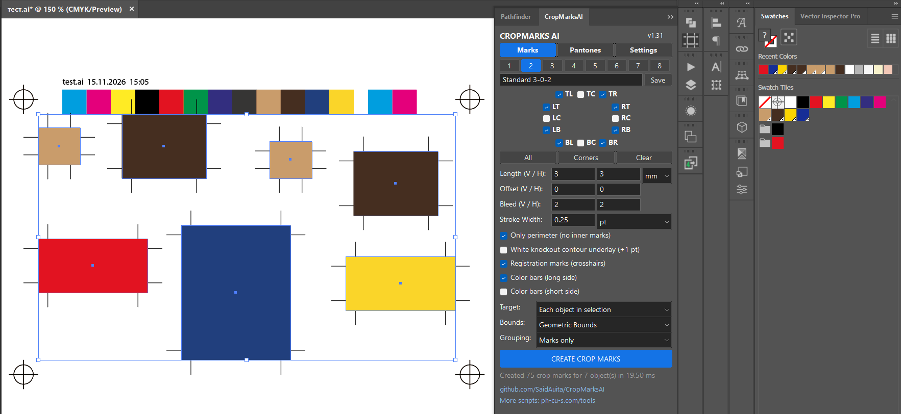
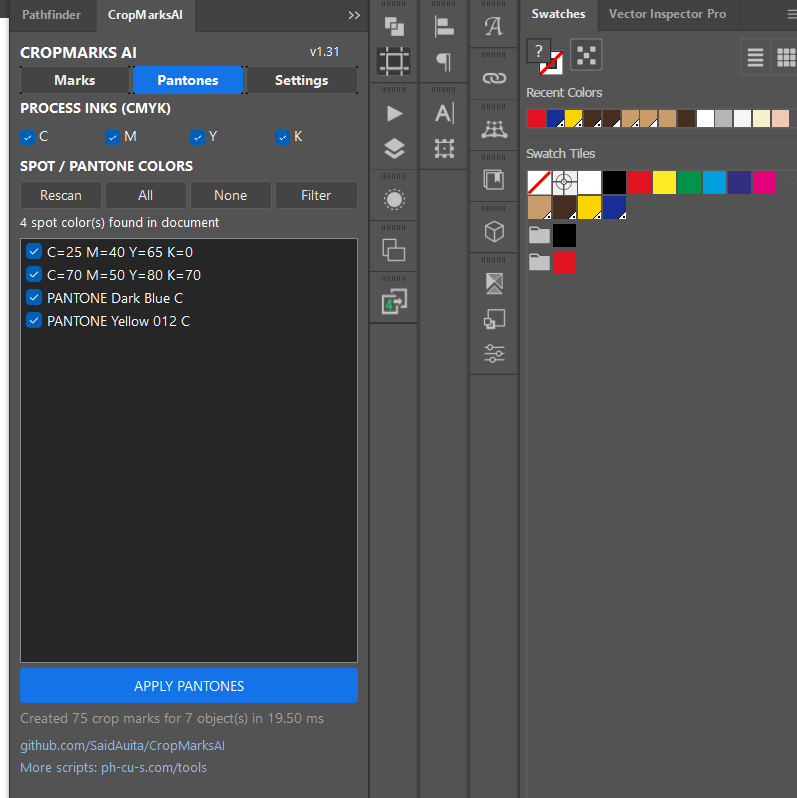
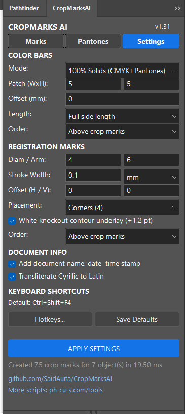
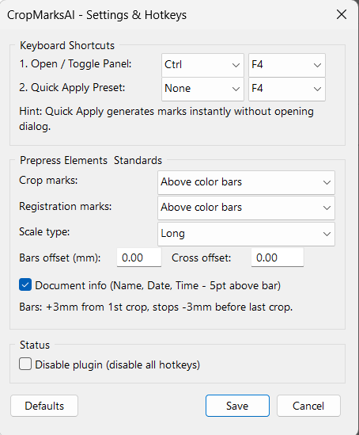

# CropMarksAI 📐🚀

[](https://www.adobe.com/products/illustrator.html)
[](https://isocpp.org/)
[](https://microsoft.com)
[](https://github.com/SaidAuita/CropMarksAI/releases)
[](LICENSE)

> **High-performance native C++ prepress plugin (`.aip`) for Adobe Illustrator (CC 2020 – 2026+ x64).**  
> Generates precision vector crop marks, fold marks, bleed offsets, Anosov registration crosshairs, ISO & 100% solid color bars with spot/Pantone scanning, and Cyrillic-transliterated document info banners in sub-millisecond time (<1 ms) directly in Illustrator process memory.

<p align="center">
  
</p>

---

[English](#english) • [Русский](#-русский)

---

<a name="english"></a>
## English

> [!TIP]
> ### 📥 Download Latest Release
> **[CropMarksAI_Plugin_v1.31.zip](https://github.com/SaidAuita/CropMarksAI/releases/download/v1.31/CropMarksAI_Plugin_v1.31.zip)** *(Direct ZIP package with one-click installer)*  
> Full release notes & assets: **[Release v1.31](https://github.com/SaidAuita/CropMarksAI/releases/tag/v1.31)**

---

### 🖥️ Unified 3-Tab Interface & Settings

<table>
  <tr>
    <td align="center" width="33%">
      <br/>
      <b>[ Marks ]</b><br/>
      <sub>Crop marks, bleed, presets & directions</sub>
    </td>
    <td align="center" width="33%">
      <br/>
      <b>[ Pantones ]</b><br/>
      <sub>Spot color scanning & smart filter</sub>
    </td>
    <td align="center" width="33%">
      <br/>
      <b>[ Settings ]</b><br/>
      <sub>Anosov crosshairs, color bars & doc info</sub>
    </td>
  </tr>
</table>

<p align="center">
  <br/>
  <em>CropMarksAI Settings & Hotkeys Modal Dialog (<code>⚙</code>)</em>
</p>

---

### ⚡ Key Features

1. **Ultra-Fast Native Performance (< 1 ms)**:
   - Direct geometry calculation and vector path construction inside `Illustrator.exe` address space using native Illustrator SDK suites (`sAIArt`, `sAIPath`, `sAIPathStyle`).
   - Up to 100× faster than traditional ExtendScript / JSX scripts on complex layouts with hundreds of objects.

2. **Unified 3-Tab Palette Architecture**:
   - **`[ Marks ]` Tab**: 12 independent crop directions, geometric settings (Length, Offset, Bleed, Stroke Width) with unit selector (mm, pt, in, px), Only perimeter mode, white knockout underlay, quick presets, and instant `CREATE CROP MARKS` action.
   - **`[ Pantones ]` Tab**: Process CMYK toggles (C, M, Y, K) and live document spot/Pantone scanning with smart technical ink filtering.
   - **`[ Settings ]` Tab**: Color bar modes & geometry, Anosov registration marks configuration, prepress document info with Cyrillic transliteration, and default hotkeys.

3. **Spot / Pantone Scanning & Smart Technical Ink Filter**:
   - **Automatic Swatch Inspection**: Scans all custom and spot inks directly from document swatches via `sAISwatchList` and `sAICustomColor`.
   - **Intelligent Technical Color Filter (`IsTechnicalSpotName`)**: Automatically detects and excludes non-printing and finishing inks (die-cuts, knives, creases, UV varnishes, foils, embossing, white ink underlays, adhesives — e.g. *штамп, вырубка, нож, биг, лак, уф, фольга, клише, белила, клей, die, cut, crease, varnish, foil, white*).
   - **Interactive Selection**: Checklist of all detected spots with live patch swatches, one-click `Rescan`, `All`, `None`, and `Filter` buttons, and `APPLY PANTONES`.

4. **Registration Marks (S. Anosov Prepress Model)**:
   - Precision prepress targets with dual concentric rings and crosshairs.
   - **Customizable Dimensions**: Configurable circle diameter (`Diam`, default 4.0 mm) and arm length (`Arm`, default 6.0 mm).
   - **Independent Line Width & Units**: Stroke width (default 0.10 mm) with unit selector (mm / pt / in / px).
   - **Independent Offsets**: Separate horizontal and vertical offsets (`regOffsetHor`, `regOffsetVer`).
   - **4 Placement Schemes**:
     - `Centers (4)`: Centered on top, bottom, left, right.
     - `Corners (4)`: Positioned at 4 sheet corners.
     - `Centers + Corners (8)`: 8 marks across all centers and corners.
     - `All 16 Directions (16)`: Full 16-point Anosov perimeter scheme (5 top, 5 bottom, 3 left, 3 right).
   - **White Knockout Contour Underlay (`+1.2 pt`)**: White background outline for maximum visibility on rich black and dark backgrounds.
   - **Z-Order Layer Ordering**: Independent choice to render crosshairs *Above* or *Below* crop marks and color bars.

5. **Advanced Color Bars & Standards**:
   - **100% Solids Mode (`CMYK + Pantones`)**: Pure 100% solid patches without halftones (Cyan, Magenta, Yellow, Black, binary overprints Red, Green, Blue, 3C grey, plus selected document Pantones).
   - **ISO 12647-2 (Commercial Offset)**: Complete gradation control, midtone TVI patches, and grey balance.
   - **ISO 12647-7 (Digital Proofing)**: Fogra Media Wedge CMYK subset with tints, overprints, and near-neutrals.
   - **Custom Patch Dimensions**: Width × Height (default 5.0 × 5.0 mm).
   - **Continuous Repetition**: Series repeats seamlessly across sheets with a 4 mm technological gap (`strip ➔ 4 mm gap ➔ strip...`).
   - **Safety Boundary**: Starts +3 mm from first crop mark, stops -3 mm before the last crop mark.
   - **Flexible Placement & Z-Order**: Independently toggle Long side (top) and Short side (left), with layer ordering *Above* or *Below* crop marks.

6. **Prepress Document Info Banner with Cyrillic Transliteration**:
   - Automatically prints document filename, date, and timestamp in 5 pt Registration color positioned 1 mm above the top color bar.
   - **Transliterate Cyrillic to Latin (`[x] Transliterate Cyrillic to Latin`)**: Automatically transliterates Cyrillic document names into clean Latin characters, eliminating RIP, PostScript, and platesetter font encoding glitches.

7. **Only Perimeter Mode & Spatial Auto-Clustering**:
   - **Only Perimeter (No Inner Marks)**: Detects grouped layouts (cards, labels, stickers) and places marks strictly along the outer bounding perimeter, eliminating unwanted internal cuts.
   - **Multi-Artboard Spatial Clustering**: Automatically isolates imposition grids across multiple artboards into dedicated groups without cross-artboard interference.
   - **Line Deduplication**: Positional cache eliminates duplicate overlapping lines with a precision tolerance of `0.002 pt`.
   - **Clipping Mask & Guide Awareness**: Binds marks to visible artwork bounds (`kArtIsClipMask`) while ignoring non-printing guides.
   - **Guaranteed Send to Back**: All marks are gathered into a single `"Crop Marks"` layer group positioned strictly below all artwork.
   - **One-Step Undo**: Fully integrated into Illustrator's native history stack (`sAIUndo->SetUndoTextUS`).

8. **8 Quick Presets & Synchronized Hotkeys**:
   - **8 Fast Preset Slots (`[1]` .. `[8]`)** with editable custom names (e.g. `Card 90x50`, `Flyer A4 Bleed 2mm`, `Packaging 6/4`). Stored persistently in `%APPDATA%\MakeCropMarksAI\presets.json`.
   - **Full Hotkey Synchronization**: Quick Apply (`Shift + F4` / `F4`) automatically synchronizes active UI parameters, checkboxes (crosshairs, color bars), and preset parameters.
   - **Keyboard Navigation**: `Tab` / `Shift + Tab` cycle focus; `Enter` generates marks from numeric fields or saves preset from name field.

---

### 📦 Installation

#### Automatic Installation (Recommended):
1. Make sure Adobe Illustrator is closed.
2. Run **`Install_Plugin.bat`** as Administrator.
3. The interactive installer will scan your system for all installed Adobe Illustrator versions (`CC 2020` .. `2026+`) and copy `CropMarksAI.aip` into the corresponding `Plug-ins\` directories.
4. Launch Illustrator. Find the panel under **`Window` ➔ `CropMarksAI`** or press **F4**.

#### Manual Installation:
Copy `CropMarksAI.aip` directly into:
```
C:\Program Files\Adobe\Adobe Illustrator [Version]\Plug-ins\
```

To uninstall, simply run **`Uninstall_Plugin.bat`** as Administrator.

---

### ⌨️ Default Hotkeys & Preferences

| Shortcut | Action | Description |
|---|---|---|
| **F4** | Toggle Panel | Shows or hides the CropMarksAI dockable palette |
| **Shift + F4** | Quick Apply | Instantly creates crop marks on selection using active preset and prepress options |
| **Enter** *(in field)* | Create / Save | Creates marks from numeric fields; saves preset from name field |
| **Tab** / **Shift+Tab** | Navigate | Moves keyboard focus through input fields and buttons |
| **Ctrl + Z** | Undo | Restores artwork state in a single undo step |

---

### 🛠️ Building from Source

- **Requirements**:
  - Microsoft Visual Studio 2022 (MSVC v143, C++17 toolset)
  - Adobe Illustrator 2026 SDK (or compatible 2020–2025 SDK)
  - Windows 10 / 11 SDK (x64)
- **Compilation**:
  Run `build.bat` from Developer Command Prompt for VS 2022, or run `node build_dev.js` to compile the `.aip` binary and assemble the release package in `Build_DEV/`.

---

### 🛠️ Other Projects

**[Clipboard Paste Native Plugin](https://github.com/SaidAuita/AI-Clipboard-Paste)**
* Ultra-fast in-memory vector duplication for Adobe Illustrator without OS clipboard overhead. Hotkeys F5–F8.

**[AI Dimension](https://github.com/SaidAuita/AI-Dimension)**
* Automatic dimensioning, gap measuring, and technical callout generator for Adobe Illustrator.

**[ID Dimension](https://github.com/SaidAuita/ID-Dimension)**
* Technical dimensioning and drafting annotation tool for Adobe InDesign (includes both CEP panel and ScriptUI palette).

**[ComfyUI Photoshop Plugin (PH-CU-S)](https://github.com/SaidAuita/ComfyUI_PH-CU-S)**
* A powerful Photoshop plugin powered by ComfyUI, providing direct integration with local generative models without any clouds, subscriptions, or recurring fees.

### 💎 QR Code with Custom Shape Logo

<table>
  <tr>
    <td align="center" width="50%">
      <a href="https://ph-cu-s.com/ai-code-pro">
        <br/>
        <b>AI Code PRO</b>
      </a><br/>
      <sub>Vector Barcodes (18 Standards) & Designer QR Codes for <b>Adobe Illustrator</b></sub><br/><br/>
      <a href="https://ph-cu-s.com/ai-code-pro"></a>
    </td>
    <td align="center" width="50%">
      <a href="https://ph-cu-s.com/id-code-pro">
        <br/>
        <b>ID Code PRO</b>
      </a><br/>
      <sub>Vector Barcodes (18 Standards) & Designer QR Codes for <b>Adobe InDesign</b></sub><br/><br/>
      <a href="https://ph-cu-s.com/id-code-pro"></a>
    </td>
  </tr>
</table>

---

### 🙏 Acknowledgments

Special thanks to **Sergey Anosov** for his foundational prepress scripting work and inspiration (`MakeCropMarksAI.jsx` and `MakeRegMarksAI.jsx`):
* **Sergey Anosov DTP Scripts:** [sites.google.com/site/dtpscripting](https://sites.google.com/site/dtpscripting)

---

<a name="-русский"></a>
## 🇷🇺 Русский

> [!TIP]
> ### 📥 Скачать последнюю версию плагина
> **[CropMarksAI_Plugin_v1.31.zip](https://github.com/SaidAuita/CropMarksAI/releases/download/v1.31/CropMarksAI_Plugin_v1.31.zip)** *(Прямая загрузка архива с автоматическим установщиком)*  
> Страница релиза и список изменений: **[Релиз v1.31](https://github.com/SaidAuita/CropMarksAI/releases/tag/v1.31)**

---

### 🖥️ Единый 3-вкладочный интерфейс и настройки

<table>
  <tr>
    <td align="center" width="33%">
      <br/>
      <b>[ Marks ]</b><br/>
      <sub>Метки реза, вылеты, 8 пресетов и 12 направлений</sub>
    </td>
    <td align="center" width="33%">
      <br/>
      <b>[ Pantones ]</b><br/>
      <sub>Сканирование спот-красок и фильтр техцветов</sub>
    </td>
    <td align="center" width="33%">
      <br/>
      <b>[ Settings ]</b><br/>
      <sub>Кресты Аносова, шкалы, транслитерация кириллицы</sub>
    </td>
  </tr>
</table>

<p align="center">
  <br/>
  <em>Модальное окно параметров и глобальных хоткеев (<code>⚙</code>)</em>
</p>

---

### ⚡ Преимущества и возможности

1. **Мгновенная скорость (< 1 мс)**:
   - Прямой расчёт геометрии и создание векторных путей внутри адресного пространства процесса `Illustrator.exe` через официальный нативный C++ SDK (`sAIArt`, `sAIPath`, `sAIPathStyle`).
   - В десятки раз быстрее традиционных ExtendScript / JSX скриптов на плотных спусках полос и макетах с сотнями объектов.

2. **Единая 3-вкладочная архитектура палитры**:
   - **Вкладка `[ Marks ]`**: 12 независимых направлений меток реза, геометрия (длина, смещение, вылеты, толщина обводки) с выбором единиц (мм, pt, дюймы, px), режим периметра, белая подложка, переключение 8 именованных пресетов и кнопка прямого построения `CREATE CROP MARKS`.
   - **Вкладка `[ Pantones ]`**: Выбор триадных красок CMYK (C, M, Y, K) и автоматическое сканирование спот-красок документа с умной фильтрацией.
   - **Вкладка `[ Settings ]`**: Тонкая настройка контрольных шкал, параметров приводных крестов модели Аносова, инфоблока документа с транслитерацией кириллицы и системных параметров.

3. **Сканирование пантонов и умный фильтр технических цветов**:
   - **Автоматический опрос каталога свотчей**: Считывание всех плашечных / спот-красок документа через SDK (`sAISwatchList`, `sAICustomColor`).
   - **Умная классификация технических слоев (`IsTechnicalSpotName`)**: Автоматическое распознавание и исключение из контрольной шкалы непечатных и отделочных красок (штамп, вырубка, нож, биг, лак, уф, фольга, клише, белила, клей, die, cut, crease, varnish, foil, white и т.д.).
   - **Интерактивный список**: Список обнаруженных красок с чекбоксами, кнопками быстрого выбора `Rescan`, `All`, `None`, `Filter` и кнопкой `APPLY PANTONES`.

4. **Приводные метки / кресты (Полиграфическая модель С. Аносова)**:
   - Высокоточные прицелы с двойным концентрическим кольцом и крестом.
   - **Настраиваемые габариты**: Диаметр кольца (`Diam`, по умолчанию 4.0 мм) и размах перекрестия (`Arm`, по умолчанию 6.0 мм).
   - **Толщина линий и единицы измерения**: Толщина обводки (по умолчанию 0.10 мм) с выбором единиц (мм / pt / in / px).
   - **Раздельные отступы**: Независимые смещения по горизонтали и вертикали (`regOffsetHor`, `regOffsetVer`).
   - **4 полиграфические схемы расстановки**:
     - `Centers (4)`: по центру 4 сторон.
     - `Corners (4)`: по 4 углам листа.
     - `Centers + Corners (8)`: центры + углы (8 крестов).
     - `All 16 Directions (16)`: полная 16-точечная схема Аносова по внешнему периметру спуска (5 сверху, 5 снизу, 3 слева, 3 справа).
   - **Белая маскирующая контурная подложка (`+1.2 pt`)**: Четкая видимость крестов на темных фонах и насыщенных плашках навылет.
   - **Управление порядком слоев (Z-Order)**: Размещение крестов поверх (`Above`) или под (`Below`) обрезными метками и шкалами.

5. **Продвинутые контрольные цветовые шкалы**:
   - **Режим 100% Solids (`CMYK + Pantones`)**: Чистые плашки 100% без растровых полутонов (Cyan, Magenta, Yellow, Black, бинарные наложения Red, Green, Blue, 3C серый, плюс выбранные пантоны документа).
   - **Стандарт ISO 12647-2 (Офсетная печать)**: Контроль градационных кривых TVI и баланса серого.
   - **Стандарт ISO 12647-7 (Цветопроба)**: Нормативный набор шкалы Fogra Media Wedge с памятными цветами и полутонами.
   - **Настраиваемый размер плашки**: Ширина × Высота (по умолчанию 5.0 × 5.0 мм).
   - **Непрерывное продление**: Серия плашек автоматически циклически повторяется вдоль листа с технологическим зазором 4 мм (`шкала ➔ зазор 4 мм ➔ шкала...`).
   - **Защитные поля**: Старт на +3 мм от первой обрезной метки, остановка за -3 мм до последней метки.
   - **Гибкое размещение и Z-Order**: Независимое включение по длинной (верх) и короткой (лево) сторонам, порядок наложения *Above* или *Below* меток.

6. **Служебный блок Document Info с транслитерацией кириллицы**:
   - Автоматический вывод имени файла, текущей даты и точного времени шрифтом 5 pt краской Registration с отступом 1 мм над верхней шкалой.
   - **Транслитерация кириллицы в латиницу (`[x] Transliterate Cyrillic to Latin`)**: Исключает сбои кодировок, кракозябры и ошибки в растровых процессорах (RIP), фотовыводных автоматах и CTP при выводе печатных форм.

7. **Режим «Только периметр» и мульти-артбордные спуски**:
   - **Режим Only perimeter**: Расставляет метки строго по внешнему периметру выделенной группы объектов (визитки, этикетки, наклейки), исключая внутренние паразитные засечки.
   - **Пространственная кластеризация**: Автоматически группирует спуски по артбордам без взаимных помех и паразитных линий через свободное пространство.
   - **Дедупликация линий**: Позиционный кэш исключает наложение повторяющихся линий с точностью до `0.002 pt`.
   - **Поддержка обтравочных масок (Clipping Mask)**: Расчет меток строго по контуру видимого содержимого с игнорированием служебных направляющих.
   - **Гарантированное опускание назад (Send to Back)**: Все метки объединяются в единую группу `"Crop Marks"` и опускаются строго под элементы макета.
   - **Отмена в один шаг (Ctrl+Z)**: Полная интеграция в стек истории Illustrator (`sAIUndo->SetUndoTextUS`).

8. **8 быстрых пресетов и синхронизация хоткеев**:
   - **8 слотов быстрых пресетов (`[1]` .. `[8]`)** с произвольными именами (например: `Визитка 90x50`, `Буклет А4 Вылет 2мм`, `Упаковка 6/4`). Сохранение в `%APPDATA%\MakeCropMarksAI\presets.json`.
   - **Синхронизация хоткеев**: Быстрое применение по хоткею (`Shift + F4` / `F4`) автоматически считывает все активные настройки панели (включая кресты, шкалы и пантоны) и синхронизирует их в активный пресет.
   - **Навигация с клавиатуры**: `Tab` / `Shift + Tab` для циклического перемещения между контролами, `Enter` для мгновенной генерации меток или сохранения имени пресета.

---

### 📦 Установка

#### Автоматическая установка (Рекомендуется):
1. Закройте Adobe Illustrator.
2. Запустите **`Install_Plugin.bat`** от имени Администратора.
3. Инсталлятор автоматически найдет установленные версии Illustrator (`CC 2020` .. `2026+`) и скопирует плагин `CropMarksAI.aip` в папки `Plug-ins\`.
4. Запустите Illustrator. Палитра доступна через меню **`Window` ➔ `CropMarksAI`** или по клавише **F4**.

#### Ручная установка:
Скопируйте `CropMarksAI.aip` в системную папку плагинов:
```
C:\Program Files\Adobe\Adobe Illustrator [Версия]\Plug-ins\
```

Для удаления запустите **`Uninstall_Plugin.bat`** от имени Администратора.

---

### ⌨️ Горячие клавиши по умолчанию

| Хоткей | Действие | Описание |
|---|---|---|
| **F4** | Открыть / свернуть панель | Открывает или сворачивает докируемую палитру CropMarksAI |
| **Shift + F4** | Быстрое применение | Мгновенно расставляет метки, кресты и шкалы по активному пресету к выделению |
| **Enter** *(в поле)* | Создать / Сохранить | В числовых полях запускает расстановку; в поле названия сохраняет пресет |
| **Tab** / **Shift+Tab** | Навигация | Перемещение фокуса ввода между полями и кнопками |
| **Ctrl + Z** | Отмена | Полная отмена действия в один шаг истории |

---

### 🛠️ Другие проекты (My Projects)

**[Clipboard Paste Native Plugin](https://github.com/SaidAuita/AI-Clipboard-Paste)**
* Сверхбыстрое дублирование векторных объектов в памяти Illustrator ядра SweetPea без задействования системного буфера Windows. Хоткеи F5–F8.

**[AI Dimension](https://github.com/SaidAuita/AI-Dimension)**
* Автоматическая простановка технических размеров, зазоров и выносных линий для Adobe Illustrator.

**[ID Dimension](https://github.com/SaidAuita/ID-Dimension)**
* Инструмент простановки чертежных размеров и аннотаций для Adobe InDesign (включает панель CEP и скрипт ScriptUI).

**[ComfyUI Photoshop Plugin (PH-CU-S)](https://github.com/SaidAuita/ComfyUI_PH-CU-S)**
* Мощный плагин для Photoshop на базе ComfyUI, обеспечивающий прямую интеграцию с локальными генеративными моделями без подписок и облаков.

### 💎 QR код с логотипом произвольной формы

<table>
  <tr>
    <td align="center" width="50%">
      <a href="https://ph-cu-s.com/ru/ai-code-pro">
        <br/>
        <b>AI Code PRO</b>
      </a><br/>
      <sub>Генератор векторных штрихкодов (18 стандартов) и дизайнерских QR-кодов для <b>Adobe Illustrator</b></sub><br/><br/>
      <a href="https://ph-cu-s.com/ru/ai-code-pro"></a>
    </td>
    <td align="center" width="50%">
      <a href="https://ph-cu-s.com/ru/id-code-pro">
        <br/>
        <b>ID Code PRO</b>
      </a><br/>
      <sub>Генератор векторных штрихкодов (18 стандартов) и дизайнерских QR-кодов для <b>Adobe InDesign</b></sub><br/><br/>
      <a href="https://ph-cu-s.com/ru/id-code-pro"></a>
    </td>
  </tr>
</table>

---

### 🙏 Благодарности (Acknowledgments)

Выражаем особую благодарность **Сергею Аносову** за многолетний фундаментальный вклад в автоматизацию допечатной подготовки для Adobe Illustrator и вдохновение для создания плагина (скрипты `MakeCropMarksAI.jsx` и `MakeRegMarksAI.jsx`):
* **Скрипты Сергея Аносова для DTP:** [sites.google.com/site/dtpscripting](https://sites.google.com/site/dtpscripting)

---

## 📄 License & Author

* **Author:** Said Auita ([GitHub: @SaidAuita](https://github.com/SaidAuita))
* **Inspiration & Prepress Algorithms:** Sergey Anosov ([sites.google.com/site/dtpscripting](https://sites.google.com/site/dtpscripting))
* **Project Repository:** [github.com/SaidAuita/CropMarksAI](https://github.com/SaidAuita/CropMarksAI)
* **Prepress Automation Hub:** [ph-cu-s.com/tools](https://ph-cu-s.com/tools)
* **License:** [MIT License](LICENSE)
